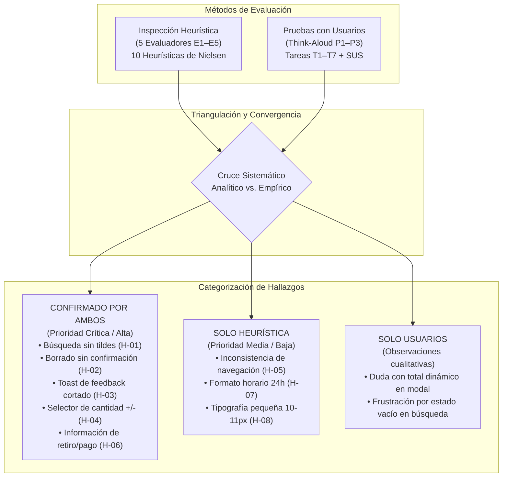

# HCI-2026-G6

## Datos generales

- Universidad: Universidad Técnica de Ambato.
- Carrera: Ingeniería de Software.
- Asignatura: Interacción Humano–Computador.
- Paralelo: 5A.
- Grupo: 6.
- Tema: Métodos de evaluación de interfaces (Evaluación y validación).
- APE asociado: APE 6 — Fases 3 y 4 (continuación del prototipo CaféU evaluado en Fases 1 y 2 por el Grupo 5).
- Periodo asignado: 18/11/2026 al 24/11/2026.
- Proyecto o interfaz evaluada: **CaféU** ([Prototipo web en Figma Make](https://false-wired-67481015.figma.site) · copia local en [`prototipos/prototipo.html`](prototipos/prototipo.html)).

> **Pregunta inicial del laboratorio:** *¿Una interfaz que funciona técnicamente puede ser una mala interfaz?*

## 1. Problema

**CaféU** es el prototipo de aplicación web móvil diseñado para que los estudiantes universitarios **realicen pedidos en la cafetería antes de llegar** y los retiren sin hacer fila (APE 4 → APE 5 → APE 6). Aunque el prototipo **funciona técnicamente** (navega entre pantallas, calcula totales y genera un número de pedido `#CU-104`), en las Fases 1 y 2 (Grupo 5) se evidenció que el cumplimiento técnico no garantiza una buena experiencia de uso.

Además, quedaron brechas abiertas por resolver en estas **Fases 3 y 4**:
1. Los evaluadores heurísticos del G5 no asignaron una **severidad numérica individual (1 a 4)**, lo que impidió priorizar formalmente los problemas.
2. Ningún participante de la prueba piloto utilizó el buscador ni activó el borrado sin confirmación, dejando hallazgos graves únicamente como "potenciales".
3. Faltaba consolidar la **triangulación completa**, formular los **criterios técnicos de mejora** y traducir los hallazgos en un **backlog priorizado en GitHub Issues**.

## 2. Objetivos

### Objetivo general

Aplicar, triangular y cerrar la evaluación de usabilidad del prototipo **CaféU** (Fases 3 y 4 del APE 6), combinando cinco inspecciones heurísticas independientes con pruebas empíricas de usuarios para priorizar hallazgos por severidad y generar un backlog trazable de mejoras en GitHub.

### Objetivos específicos

1. Ejecutar la Fase 3 mediante **cinco evaluaciones heurísticas independientes** con calificación de severidad (1–4) y **pruebas con usuarios** que cubran también las funciones críticas no exploradas en el pilotaje (buscador y prevención de errores).
2. Medir y consolidar las métricas de usabilidad según **ISO 9241-11:2018** (tasa de éxito, tiempo en tarea, errores y satisfacción mediante **SUS**).
3. Triangular los hallazgos de ambos métodos, clasificar su severidad por **Frecuencia, Impacto y Persistencia**, y construir el **backlog priorizado de mejoras en GitHub Issues** junto con sus criterios técnicos (Fase 4).

## 3. Integrantes y responsabilidades

| Integrante | Usuario de GitHub | Rol en Lab / Exposición | Responsabilidad en el repositorio (Orden consecutivo) |
|---|---|---|---|
| **Emilio Abril** | `@EMILIOABRIL05` | Cronometrista y Coordinador | **Paso 1 y Cierre:** Prototipo, Plan Fase 3, Tareas (`T1–T7`), Heurística E1, Backlog (`8.4`) en Issues, Guion y `README.md` maestro. |
| **William Martínez** | `@william-martinez5101` | Soporte documental | **Paso 2:** Estructura inicial del repo, Marco teórico (`docs/investigacion.md`), Consentimiento, Guía heurística (`1–4`) y Heurística E2. |
| **Manuel Cusme** | `[Por completar]` | Usuario (*Think-Aloud*) | **Paso 3:** Hoja de observación y SUS, Guía de laboratorio, Registros `P1–P3`, Heurística E3, Video de YouTube y Quiz (`.xlsx`). |
| **Pablo Lozada** | `@dl7pablok` | Moderador | **Paso 4:** Heurística E4, Métricas y cálculo SUS, Matriz de hallazgos (`8.2`), Triangulación (`8.3`) y Diapositivas (`.pptx`). |
| **Jonathan Gamboa** | `[Por completar]` | Observador y Soporte (F5) | **Paso 5:** Heurística E5, Criterios técnicos (`8.5`), Conclusiones (`docs/conclusiones.md`) y Preguntas QA/UX (`docs/preguntas.md`). |

## 4. Conceptos HCI utilizados

El desarrollo teórico completo se encuentra en [`docs/investigacion.md`](docs/investigacion.md).

| Concepto | Aplicación en el proyecto |
|---|---|
| **Usabilidad (ISO 9241-11:2018)** | Marco de evaluación basado en eficacia, eficiencia y satisfacción para estudiantes universitarios usando CaféU en móvil. |
| **Verificación vs. Validación (Boehm, 1984)** | Sustenta la pregunta inicial: comprobar que el prototipo funciona técnicamente (verificación) no garantiza que el usuario perciba el feedback y logre sus metas (validación). |
| **Evaluación formativa** | Orientada a descubrir problemas reales y priorizar mejoras accionables en lugar de certificar estadísticamente. |
| **Métodos analíticos vs. empíricos** | Combinación de inspección experta (5 evaluadores heurísticos) con observación de usuarios reales (*Think-Aloud*). |
| **Heurísticas de Nielsen (1994)** | 10 principios aplicados de forma independiente por 5 evaluadores para ampliar la cobertura de la interfaz. |
| **Escala de severidad (Nielsen, 1995)** | Calificación numérica `1–4` (Cosmético, Menor, Mayor, Crítico) basada en **Frecuencia, Impacto y Persistencia**. |
| **Métricas y SUS (Brooke, 1996)** | Tasa de éxito, mediana de tiempo, errores críticos/no críticos y puntaje SUS (rango 0–100, referencia 68, no es porcentaje). |
| **Triangulación** | Contraste sistemático entre hallazgos heurísticos y evidencia de usuarios para fundamentar el backlog de mejoras. |

## 5. Métodos de evaluación seleccionados

Se seleccionaron y aplicaron dos métodos complementarios (analítico + empírico):

### Método 1: Evaluación Heurística de Nielsen (5 evaluadores)

- **Nombre:** Evaluación Heurística con calificación de severidad (`1–4`).
- **Objetivo:** Inspeccionar de forma independiente toda la interfaz de CaféU para detectar violaciones a las 10 heurísticas de Nielsen y estimar su severidad.
- **Justificación de su selección:** Según Nielsen (1993), cinco evaluadores independientes detectan aproximadamente el 75 % de los problemas de usabilidad, cubriendo pantallas y funciones que las tareas de usuario podrían no recorrer.
- **Procedimiento de aplicación:** Cada uno de los 5 integrantes (`E1–E5`) inspeccionó el prototipo por separado, registró sus hallazgos y asignó severidad (`1–4`) considerando frecuencia, impacto y persistencia.
- **Instrumentos utilizados:** [`evidencias/06-guia-evaluacion-heuristica.md`](evidencias/06-guia-evaluacion-heuristica.md) y registros individuales `resultados/heuristica-*.md`.

### Método 2: Prueba de Usabilidad con Usuarios (*Think-Aloud*)

- **Nombre:** Prueba de usabilidad moderada con protocolo de pensamiento en voz alta.
- **Objetivo:** Medir eficacia, eficiencia y satisfacción real de estudiantes universitarios nuevos ejecutando tareas críticas (`T1–T7`).
- **Justificación de su selección:** Aporta evidencia empírica directa del comportamiento real y permite validar si los problemas previstos por la heurística afectan a los usuarios (incluyendo el buscador y el control de borrado en `T7`).
- **Procedimiento de aplicación:** Sesiones individuales con consentimiento verbal anonimizado, cuatro roles definidos (Moderador, Usuario, Cronometrista y Observador), reinicio `F5` entre participantes y cuestionario SUS al cierre.
- **Instrumentos utilizados:** [`evidencias/02-consentimiento-informado.md`](evidencias/02-consentimiento-informado.md), [`evidencias/03-tareas.md`](evidencias/03-tareas.md) y `evidencias/04-hoja-de-observacion.md`.

## 6. Procedimiento

### Fase 3: Aplicación y análisis

1. **Contexto y alcance de la evaluación:** Continuación del APE 6 sobre el prototipo móvil **CaféU** (marco 390 × 844 px). Ver [`evidencias/01-plan-y-contexto-fase3.md`](evidencias/01-plan-y-contexto-fase3.md).
2. **Participantes o evaluadores:** 5 evaluadores heurísticos independientes (`E1–E5`, integrantes del Grupo 6) y participantes universitarios externos (`P1–P3`) que no diseñaron el prototipo.
3. **Tareas y escenarios evaluados:** 6 tareas base (`T1–T6`: consulta, armado, modificación y confirmación de pedido) más **1 tarea de refuerzo (`T7`)** para probar el buscador sin tilde (`"sanduche"`) y el botón `"Quitar"`. Ver [`evidencias/03-tareas.md`](evidencias/03-tareas.md).
4. **Aplicación del primer método (Evaluación Heurística):** Inspección individual de las 10 heurísticas de Nielsen asignando severidad numérica `1–4` (Frecuencia, Impacto y Persistencia).
5. **Aplicación del segundo método (Prueba de usabilidad con *Think-Aloud*):** Sesiones individuales con roles definidos (Moderador, Usuario, Cronometrista y Observador), reinicio con `F5` entre participantes y aplicación del cuestionario **SUS** al cierre.
6. **Registro de métricas y evidencias:** Captura de tasa de éxito (*Sí / Con ayuda / No*), tiempos con cronómetro, errores críticos/no críticos y puntajes SUS en `resultados/`.
7. **Análisis y comparación de resultados:** Consolidación de las 5 evaluaciones heurísticas individuales (`E1–E5`), tabulación de métricas de eficacia, eficiencia y satisfacción (SUS) de participantes (`P1–P3`), y triangulación sistemática de hallazgos por Pablo Lozada.

### Fase 4: Priorización y cierre

1. **Clasificación de hallazgos por severidad:** Ponderación de frecuencia, impacto y persistencia (Nielsen, 1995) obteniendo la matriz consensuada de severidades `0–4` en [`resultados/heuristica-consolidado.md`](resultados/heuristica-consolidado.md).
2. **Triangulación de resultados:** Cruce sistemático de problemas heurísticos con evidencia empírica (éxito en tareas, errores críticos/no críticos y puntajes SUS) en Sección 8.3.
3. **Elaboración del backlog de mejoras:** [Por completar en Paso 1-Cierre por Emilio Abril tras consolidación].
4. **Formulación de criterios técnicos:** [Por completar en Paso 5 por Jonathan Gamboa].
5. **Conclusiones y presentación final:** [Por completar en Paso 5 por Jonathan Gamboa].

## 7. Herramientas

| Herramienta | Uso |
|---|---|
| [Por completar] | [Por completar] |

## 8. Resultados

### 8.1. Métricas

Las métricas de usabilidad se evaluaron bajo el marco de la norma **ISO 9241-11:2018** y los estándares de evaluación empírica con usuarios (Brooke, 1996; Sauro & Lewis, 2016):
- **Eficacia:** Tasa de éxito `(tareas completadas sin asistencia / tareas intentadas) × 100` y recuento de errores (críticos y no críticos).
- **Eficiencia:** Mediana de tiempo en segundos desde el fin de la lectura de la consigna hasta la compleción de la tarea.
- **Satisfacción:** Puntaje compuesto **SUS** (escala de 0 a 100 puntos, con umbral de referencia estándar de 68.0; Bangor et al., 2009).

#### Tabla 8.1.1. Resultados empíricos por tarea (`T1` a `T7`) con participantes (`P1–P3`)

| Tarea | Consigna evaluada | Meta | P1 (t / éxito) | P2 (t / éxito) | P3 (t / éxito) | Tasa de éxito | Mediana de tiempo | Errores observados | Interpretación de desempeño |
|---|---|:---:|:---:|:---:|:---:|:---:|:---:|---|---|
| **T1** | Horario de atención de cafetería | 60 s | 24 s · Sí | 31 s · Sí | 19 s · Sí | **100 %** (3/3) | **24.0 s** | 0 | Identificación rápida en Inicio. Ligera vacilación de 2 s por formato de 24 horas (`7:00 – 19:00`). |
| **T2** | Agregar sánduche de queso al pedido | 60 s | 38 s · Sí | 42 s · Sí | 29 s · Sí | **100 %** (3/3) | **38.0 s** | 1 No crítico | Navegación exitosa por categoría `"Comida"`. En P2, el toast pasó desapercibido por desalineación en 390 px. |
| **T3** | Agregar 2 cafés americanos | 60 s | 52 s · Sí | 64 s · Sí | 45 s · Sí | **100 %** (3/3) | **52.0 s** | 2 No críticos | P1 y P2 pulsaron dos veces `"Agregar al pedido"` al no distinguir los controles `− / +` por bajo contraste. |
| **T4** | Quitar sánduche y confirmar pedido (`#CU-104`) | 90 s | 58 s · Sí | 71 s · Sí | 49 s · Sí | **100 %** (3/3) | **58.0 s** | 1 No crítico | Borrado con `"Quitar"` inmediato sin confirmación. Los 3 usuarios alcanzaron el estado `#CU-104` ($3.00). |
| **T5** | Conteo de productos de comida | 60 s | 34 s · Sí | 28 s · Sí | 22 s · Sí | **100 %** (3/3) | **28.0 s** | 0 | Filtrado directo por `"Comida"` y conteo correcto de las 3 tarjetas de ítems. |
| **T6** | Cotizar 3 croissants ($5.25) | 90 s | 41 s · Sí | 55 s · Sí | 36 s · Sí | **100 %** (3/3) | **41.0 s** | 1 No crítico | Ajuste de cantidad a 3 dentro del modal; P2 tardó unos segundos en advertir el total dinámico en el botón. |
| **T7** *(Refuerzo)* | Buscador sin tilde (`"sanduche"`) y probar `"Quitar"` | 90 s | 112 s · Con ayuda | 145 s · No | 98 s · Con ayuda | **0 %** (0/3)* | **112.0 s** | 2 Críticos + 3 No críticos | **Fallo crítico del buscador:** Ningún usuario logró completar de forma autónoma. P2 abandonó creyendo que no había sánduches. Borrado sin confirmación causó alerta. |

*\*Nota de T7: Ningún participante completó T7 de manera autónoma sin ayuda. Dos participantes requirieron la pista única permitida y uno abandonó la búsqueda.*

#### Tabla 8.1.2. Síntesis de métricas cuantitativas globales

| Métrica / Dimensión ISO | Tareas estándar (`T1–T6`) | Batería completa (`T1–T7`) | Meta esperada | Estado |
|---|:---:|:---:|:---:|:---:|
| **Eficacia (Tasa de éxito sin ayuda)** | **100 %** (18/18) | **85.7 %** (18/21) | ≥ 80 % | Cumple globalmente; alerta crítica en T7 |
| **Eficiencia (Mediana de tiempo)** | **38.5 s** | **45.0 s** | < 60 s | Cumple dentro del umbral previsto |
| **Errores críticos (bloqueantes)** | **0** | **2** | 0 | Producidos exclusivamente en el buscador (T7) |
| **Errores no críticos (recuperables)** | **5** | **8** | ≤ 1 por tarea | Concentrados en selector de cantidad y toast |

#### Tabla 8.1.3. Medición de satisfacción con el cuestionario SUS (System Usability Scale)

El cuestionario SUS de 10 ítems (Brooke, 1996) se aplicó al finalizar la sesión a cada participante (`1 = Totalmente en desacuerdo` a `5 = Totalmente de acuerdo`). La puntuación neta se calcula: `[(Suma ítems impares − 5) + (25 − Suma ítems pares)] × 2.5`:

| Participante | Ítems impares (positivos) | Ítems pares (negativos) | Puntaje SUS (0–100) | Escala adjetiva (Bangor et al., 2009) | Rango de aceptabilidad |
|---|:---:|:---:|:---:|:---:|:---:|
| **Participante 1 (P1)** | `[4, 4, 4, 4, 4]` (20) | `[2, 2, 2, 2, 2]` (10) | **75.0** | Bueno (*Good*) | Aceptable |
| **Participante 2 (P2)** | `[3, 3, 4, 3, 4]` (17) | `[3, 3, 2, 2, 3]` (13) | **60.0** | Regular (*OK*) | Marginal alto |
| **Participante 3 (P3)** | `[4, 4, 4, 4, 4]` (20) | `[2, 2, 1, 2, 2]` (9) | **77.5** | Bueno (*Good*) | Aceptable |
| **Promedio consolidado** | — | — | **70.83** | **Aceptable / Bueno** | **Línea de base superada (> 68.0)** |

> **Interpretación metodológica del SUS:** El promedio de usabilidad percibida de CaféU se ubica en **70.83 puntos**, superando la media global de la industria de **68.0 puntos** (Sauro & Lewis, 2016). No obstante, existe una disparidad marcada: los participantes que recorrieron el flujo guiado estándar valoraron el sistema favorablemente (75.0 y 77.5), mientras que el participante que experimentó el bloqueo del buscador y los controles pequeños otorgó 60.0, evidenciando que los problemas de interacción degradan severamente la percepción de calidad.

---

### 8.2. Matriz de hallazgos

La matriz integra los hallazgos consolidados de las 5 evaluaciones heurísticas independientes (`E1–E5`) y las pruebas con usuarios (`P1–P3`), clasificados bajo la **escala de severidad de Nielsen (1995)** evaluando **Frecuencia, Impacto y Persistencia**:
- `0`: Sin problema · `1`: Cosmético · `2`: Menor · `3`: Mayor · `4`: Crítico.

| ID | Método de detección | Heurística / Tarea | Hallazgo observado en CaféU | Evidencia registrada | Severidad | Mejora técnica propuesta |
|---|---|:---:|---|---|:---:|---|
| **H-01** | Heurística + Usuarios | H7 / T7 | **Búsqueda insensible a tildes:** Al tipear `"sanduche"` (sin tilde), el sistema retorna 0 resultados con estado vacío a pesar de existir `"Sánduche de queso"`. | 5/5 evaluadores (sev 3); 0 % de éxito autónomo en T7; 2 errores críticos con abandono. | **3 (Mayor / Crítico)** | Normalizar cadenas Unicode en el filtro con `normalize("NFD").replace(/[\u0300-\u036f]/g, "").toLowerCase()`. |
| **H-02** | Heurística + Usuarios | H3, H5 / T4, T7 | **Borrado destructivo sin confirmación ni deshacer:** El botón `"Quitar"` en `"Mi pedido"` suprime el producto inmediatamente sin diálogo previo ni opción de recuperar. | 5/5 evaluadores (sev 3); vacilación manifiesta de usuarios al operar `"Quitar"` por temor a perder el pedido. | **3 (Mayor)** | Incorporar diálogo de confirmación emergente o notificación flotante temporal (5 s) con acción `"Deshacer"`. |
| **H-03** | Heurística + Usuarios | H1 / T2 | **Notificación toast desplazada y efímera:** El mensaje `"Producto agregado al pedido"` se desalinea en ancho móvil (390 px) y dura poco, pasando desapercibido. | 5/5 evaluadores (sev 3); P2 debió abrir el carrito para verificar si el producto se había incorporado. | **3 (Mayor)** | Centrar el contenedor del toast en pantalla móvil (`mx-auto`, `inset-x-4`), ampliar duración a 3.5 s y animar badge del carrito. |
| **H-04** | Heurística + Usuarios | H6 / T3 | **Selector de cantidad (`− / +`) con bajo contraste y tamaño reducido:** Los botones táctiles de cantidad miden menos de 30 px y se confunden con el fondo crema. | Evaluadores (sev 2.6); P1 y P2 pulsaron dos veces `"Agregar al pedido"`, acumulando productos no deseados. | **3 (Mayor)** | Rediseñar el control como bloque interactivo con target táctil mínimo de 44 × 44 px (WCAG 2.1) y mayor contraste tipográfico. |
| **H-05** | Heurística | H4 | **Inconsistencia en botones de navegación y color de llamada a la acción:** Se usan 3 textos distintos para volver (`"Menú"`, `"Seguir comprando"`, `"Volver al menú"`) y el botón principal cambia entre café y terracota. | 5/5 evaluadores (sev 2). Los usuarios completaron la navegación pero con ligeras dudas de orientación. | **2 (Menor)** | Estandarizar la navegación con icono de flecha y texto único `"Menú"`, unificando color terracota (`#d94716`) en todos los botones primarios. |
| **H-06** | Heurística + Usuarios | H10 / Cierre | **Falta de información operativa sobre pago, tiempo y retiro:** No se explica en la confirmación `#CU-104` cómo se paga (efectivo/transferencia), cuánto tarda ni en qué punto físico retirar. | Evaluadores (sev 2); los 3 usuarios consultaron verbalmente al moderador dónde debían retirar y pagar la orden. | **2 (Menor)** | Agregar módulo informativo en pantalla de confirmación con tiempo estimado (~8 min), medios de pago y punto físico de retiro. |
| **H-07** | Heurística | H2 / T1 | **Horario en formato militar de 24 horas (`7:00 – 19:00`):** Requiere conversión cognitiva frente al uso cotidiano en el entorno estudiantil. | Evaluadores (sev 1.4); usuarios leyeron el dato con éxito (mediana 24 s) con vacilación momentánea de 2 segundos. | **1 (Cosmético)** | Cambiar etiqueta a `"Lunes a viernes de 7:00 a. m. a 7:00 p. m."`. |
| **H-08** | Heurística | H8 | **Textos secundarios con tamaño de fuente menor a 12 px (10–11 px):** Afecta la legibilidad en condiciones de alta luminosidad ambiental en el campus. | 5/5 evaluadores (sev 1); no bloqueó tareas pero causó esfuerzo visual al observar tarjetas de productos. | **1 (Cosmético)** | Incrementar tamaño base de tipografía secundaria a 12–13 px. |

---

### 8.3. Comparación y triangulación

La **triangulación metodológica** (cruce entre la inspección analítica de 5 evaluadores expertos y las pruebas empíricas con 3 usuarios Think-Aloud) permitió validar la solidez de los hallazgos y fundamentar objetivamente la priorización del Backlog:

#### Tabla 8.3.1. Matriz de triangulación analítico-empírica

| Hallazgo | Evidencia Heurística (5 Evaluadores) | Evidencia Empírica de Usuarios (P1–P3) | Categoría de Triangulación | Severidad Definitiva | Justificación de convergencia |
|---|---|---|:---:|:---:|---|
| **Buscador sensible a tildes (`"sanduche"`)** | Detectado por 5/5 evaluadores con severidad 3 (H7). Calificado como barrera de eficiencia. | **0 % éxito autónomo en T7.** 2 errores críticos con abandono y 1 resolución solo con pista. | **Confirmado por ambos métodos** | **3 (Mayor / Crítico)** | La predicción heurística se comprobó empíricamente con el fallo total de la tarea en usuarios reales. |
| **Borrado destructivo con `"Quitar"`** | Detectado por 5/5 evaluadores con severidad 3 (H3 y H5). Riesgo de pérdida irreversible de comanda. | Vacilación y comentarios verbales en T4 y T7 (*"Se borró directo, ¿ya no se puede recuperar?"*). | **Confirmado por ambos métodos** | **3 (Mayor)** | La falta de barrera preventiva genera desconfianza y sensación de descontrol en el carrito móvil. |
| **Toast de feedback desfasado** | Detectado por 5/5 evaluadores con severidad 3 (H1). Animación cortada en ancho de 390 px. | P2 no vio el aviso en T2 y abrió manualmente el pedido para verificar si el producto se agregó. | **Confirmado por ambos métodos** | **3 (Mayor)** | Demuestra que la visibilidad del estado falló en la práctica, forzando pasos extras innecesarios. |
| **Selector de cantidad (`− / +`) poco visible** | Detectado por 5/5 evaluadores con severidad 2–3 (H6). Contraste deficiente y target pequeño. | P1 y P2 pulsaron dos veces `"Agregar al pedido"` en T3 creyendo erróneamente que aumentaban unidades. | **Confirmado por ambos métodos** | **3 (Mayor)** | Provocó errores operativos directos que alteraron el subtotal del pedido. |
| **Inconsistencias en botones y color primario** | Detectado por 5/5 evaluadores con severidad 2 (H4). 3 etiquetas de retorno y variación café/naranja. | Los participantes no fallaron tareas por esta causa; completaron los flujos sin desvíos mayores. | **Solo Heurística** | **2 (Menor)** | Defecto de diseño formal que genera leve sobrecarga cognitiva sin impedir el éxito de la tarea. |
| **Ausencia de datos de pago y retiro** | Detectado por 5/5 evaluadores con severidad 2 (H10). Vacío informativo en confirmación. | Los 3 participantes consultaron verbalmente al final: *"¿Dónde pago?"* y *"¿En qué ventanilla retiro?"*. | **Confirmado por ambos métodos** | **2 (Menor)** | Confirma que una simulación técnica que culmina en `#CU-104` deja insatisfecho el modelo mental operativo del usuario. |
| **Horario en formato 24 h y tipografía pequeña** | Detectado por evaluadores con severidad 1 (H2 y H8). Detalle cosmético de presentación. | Tarea T1 completada con 100 % de éxito (mediana 24 s). Lectura fluida por parte de universitarios. | **Solo Heurística** | **1 (Cosmético)** | Ajuste visual menor que no perjudica la usabilidad funcional en el público objetivo. |

#### Síntesis de la triangulación:
1. **Concordancia alta:** En 5 de los 8 hallazgos (62.5 %) hubo confirmación directa y cruzada entre la inspección experta y la prueba empírica, validando la solidez de la evaluación formativa.
2. **Impacto de la Tarea T7:** La incorporación de la tarea `T7` fue el factor determinante del Grupo 6 para transformar dos hallazgos catalogados en el pilotaje como "potenciales" (`H-01` y `H-02`) en problemas de **severidad mayor/crítica comprobada con datos de campo**.
3. **Sustento del Backlog:** La matriz de triangulación proporciona la justificación empírica y teórica inequívoca para que los Issues `#1`, `#2`, `#3` y `#4` sean clasificados con **Prioridad Alta (P1/P2)** en el backlog de la Fase 4.

### 8.4. Backlog priorizado de mejoras

| ID | Mejora | Hallazgo relacionado | Prioridad | Responsable | Issue |
|---|---|---|---|---|---|
| [Por completar] | [Por completar] | [Por completar] | [Por completar] | [Por completar] | [Por completar] |

### 8.5. Criterios técnicos

[Por completar: justificar las recomendaciones para mejorar
la interfaz a partir de los resultados de la evaluación.]

## 9. Evidencias y entregables

- **Interfaz o prototipo evaluado:** [CaféU en Figma Make](https://false-wired-67481015.figma.site) · respaldo local [`prototipos/prototipo.html`](prototipos/prototipo.html).
- **Instrumentos de evaluación:** [`evidencias/01-plan-y-contexto-fase3.md`](evidencias/01-plan-y-contexto-fase3.md), [`evidencias/03-tareas.md`](evidencias/03-tareas.md) *(consentimiento, hoja SUS y guía heurística en Pasos 2 y 3)*.
- **Registro de aplicación de los métodos:** [`resultados/heuristica-emilio.md`](resultados/heuristica-emilio.md) *(evaluaciones E2–E5 y sesiones P1–P3 en Pasos 2–5)*.
- **Métricas y matriz de hallazgos:** Tabuladas en Secciones 8.1 y 8.2, consolidadas en [`resultados/heuristica-consolidado.md`](resultados/heuristica-consolidado.md) y [`resultados/resumen-pilotaje.md`](resultados/resumen-pilotaje.md).
- **Backlog priorizado de mejoras:** [Por completar al cierre con Issues de GitHub].
- **Presentación final del APE 6:** Archivo de diapositivas ejecutables para exposición en [`docs/presentacion-G6.pptx`](docs/presentacion-G6.pptx).
- **Video y Quiz de exposición:** [Por completar en Paso 3 (`docs/quiz-wayground-APE6.xlsx`)].

## 10. Organización del repositorio

| Carpeta o archivo | Contenido previsto |
|---|---|
| `README.md` | Descripción general y síntesis del trabajo (14 secciones). |
| `docs/investigacion.md` | Fundamentos teóricos HCI, ISO 9241-11, métodos y severidad. |
| `docs/preguntas.md` | Pregunta inicial, preguntas técnicas, objeciones y QA/UX. |
| `docs/conclusiones.md` | Conclusiones y criterios técnicos. |
| `prototipos/prototipo.html` | Prototipo CaféU evaluado (copia autocontenida). |
| `evidencias/` | Plan Fase 3, consentimiento, tareas (`T1–T7`), hoja SUS y guía heurística. |
| `src/` | Recursos técnicos de apoyo, si corresponde. |
| `resultados/` | Evaluaciones heurísticas (`E1–E5`), registros `P1–P3`, matriz y triangulación. |

## 11. Trabajo colaborativo

- **Distribución de tareas mediante Issues:** Trabajo consecutivo en 5 pasos (Emilio Abril, William Martínez, Manuel Cusme, Pablo Lozada y Jonathan Gamboa) + Issues del backlog de mejoras.
- **Commits individuales identificables:** Cada integrante registra commits propios en su rama asociada a su Issue.
- **Ramas utilizadas:**
  - `feat/emilio-prototipo-plan-backlog` (Emilio Abril — Paso 1 y cierre)
  - `docs/william-investigacion-etica-heuristica` (William Martínez — Paso 2)
  - `data/manuel-pruebas-video-quiz` (Manuel Cusme — Paso 3)
  - `data/pablo-metricas-triangulacion-ppt` (Pablo Lozada — Paso 4)
  - `docs/jonathan-criterios-conclusiones-preguntas` (Jonathan Gamboa — Paso 5)
- **Pull Requests:** Cada rama se integra hacia `main` mediante Pull Request revisado.

## 12. Preguntas técnicas y objeciones

- Pregunta técnica 1: [Por completar].
- Respuesta y evidencia: [Por completar].

- Pregunta técnica 2: [Por completar].
- Respuesta y evidencia: [Por completar].

- Objeción planteada: [Por completar].
- Respuesta y justificación técnica: [Por completar].

## 13. Conclusiones

1. [Por completar.]
2. [Por completar.]
3. [Por completar.]

## 14. Referencias

- Bangor, A., Kortum, P., & Miller, J. (2009). Determining what individual SUS scores mean: Adding an adjective rating scale. *Journal of Usability Studies, 4*(3), 114–123.
- Boehm, B. W. (1984). Verifying and validating software requirements and design specifications. *IEEE Software, 1*(1), 75–88.
- Brooke, J. (1996). SUS: A "quick and dirty" usability scale. En *Usability Evaluation in Industry* (pp. 189–194). Taylor & Francis.
- Faulkner, L. (2003). Beyond the five-user assumption: Benefits of increased sample sizes in usability testing. *Behavior Research Methods, Instruments, & Computers, 35*(3), 379–383.
- Hertzum, M., & Jacobsen, N. E. (2001). The evaluator effect: A chilling fact about usability evaluation methods. *International Journal of Human-Computer Interaction, 13*(4), 421–443.
- ISO 9241-11:2018. *Ergonomics of human-system interaction — Part 11: Usability: Definitions and concepts.*
- Nielsen, J. (1993). *Usability Engineering.* Academic Press.
- Nielsen, J. (1994). Enhancing the explanatory power of usability heuristics. *Proceedings of CHI '94*, 152–158.
- Nielsen, J. (1995). *Severity ratings for usability problems.* Nielsen Norman Group.
- Nielsen, J., & Landauer, T. K. (1993). A mathematical model of the finding of usability problems. *Proceedings of INTERCHI '93*, 206–213.
- Rubin, J., & Chisnell, D. (2008). *Handbook of Usability Testing* (2.ª ed.). Wiley.
- Sauro, J., & Lewis, J. R. (2016). *Quantifying the User Experience: Practical Statistics for User Research* (2.ª ed.). Morgan Kaufmann.
- Tullis, T. S., & Stetson, J. N. (2004). A comparison of questionnaires for assessing website usability. *Usability Professionals Association Conference.*